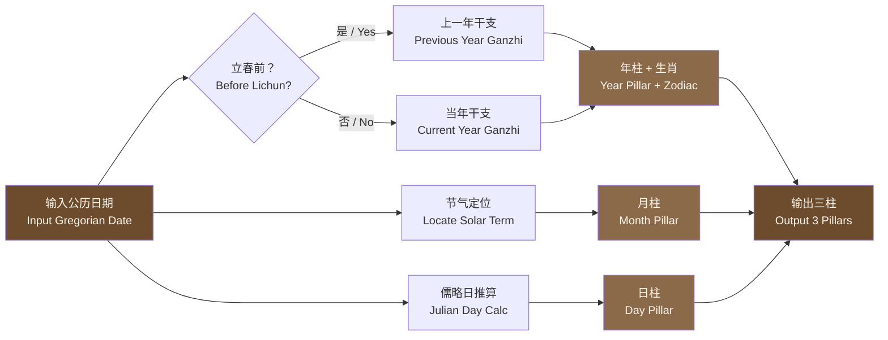
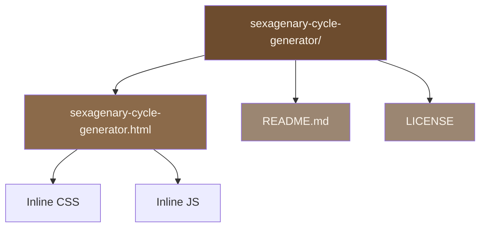

干支纪年生成器（Sexagenary Cycle Generator）

<div align="center">


<a href="#">
  
</a>

一个单文件、零依赖的中国干支纪年生成器。选择任意日期，一键生成该日的年干支 + 生肖、月干支、日干支，支持明暗主题与移动端。

A single-file, zero-dependency Chinese Ganzhi (Sexagenary Cycle) generator. Pick any date and instantly get the year pillar (with zodiac), month pillar, and day pillar in stem-branch names. Supports light/dark theme and mobile devices.

</div>

---

目录 / Table of Contents

<div align="center">

章节 / Section 快速跳转 / Jump
项目简介 / Introduction 前往
功能特点 / Features 前往
快速开始 / Quick Start 前往
使用说明 / Usage 前往
计算规则 / Calculation Rules 前往
技术要点 / Tech Highlights 前往
已知限制 / Limitations 前往
贡献指南 / Contributing 前往

</div>

---

项目简介 / Introduction

<div align="center">
  
</div>

干支纪年是中国传统的纪年方式，由十天干（甲乙丙丁戊己庚辛壬癸）与十二地支（子丑寅卯辰巳午未申酉戌亥）循环组合，形成六十甲子。

本项目是一个纯前端、单 HTML 文件的干支日期生成器，打开即用，无需安装、无需构建、无任何第三方依赖。

The Sexagenary Cycle (Ganzhi) is a traditional Chinese calendrical system formed by pairing the Ten Heavenly Stems (Jia, Yi, Bing, Ding, Wu, Ji, Geng, Xin, Ren, Gui) with the Twelve Earthly Branches (Zi, Chou, Yin, Mao, Chen, Si, Wu, Wei, Shen, You, Xu, Hai), producing a 60-year cycle.

This project is a pure front-end, single-HTML-file Ganzhi date generator. Open it in any browser and it works — no installation, no build step, no third-party dependencies.

<div align="center">

输入一个公历日期，点击「生成」，即可得到：

Input a Gregorian date and click "Generate" to get:

```
+----------------------------------+
|                                  |
|     乙巳蛇年  戊寅月  甲子日     |
|                                  |
+----------------------------------+
```

即年柱（含生肖）+ 月柱 + 日柱三柱干支。

That is the Year Pillar (with zodiac) + Month Pillar + Day Pillar — three pillars in total.

</div>

---

功能特点 / Features

<div align="center">
  
</div>

· 单文件：整个应用就是一个 .html 文件，双击即用，便于分享与部署。
· 零依赖：纯原生 HTML/CSS/JavaScript，不引入任何库或框架。
· 年/月/日三级干支：年柱按立春换年，月柱按节气换月，日柱按儒略日推算。
· 生肖显示：年干支后自动附带对应十二生肖。
· 节气天文计算：内置太阳视黄经近似算法 + 二分法求解节气时刻。
· 明暗主题：默认跟随系统 prefers-color-scheme，右上角开关可手动切换。
· 移动端适配：响应式布局，小屏自动缩放字号与间距。
· 输入校验：无效日期会提示「请选择有效日期」，计算异常有兜底提示。
· 占位提示：选择日期后，结果区先显示「日期 + 星期」占位，点击生成后替换为干支。
· Single file: The entire app is one .html file — double-click to run, easy to share and deploy.
· Zero dependencies: Pure vanilla HTML/CSS/JavaScript — no libraries or frameworks.
· Year/Month/Day pillars: Year pillar switches at Lichun, month pillar switches at solar terms, day pillar calculated via Julian Day.
· Zodiac display: The corresponding Chinese zodiac animal is appended to the year pillar.
· Astronomical solar terms: Built-in approximate solar apparent longitude algorithm + bisection method to solve solar term instants.
· Light & dark theme: Follows system prefers-color-scheme by default; manual toggle in the top-right corner.
· Mobile responsive: Responsive layout — font sizes and spacing scale down on small screens.
· Input validation: Invalid dates show "Please select a valid date"; calculation errors are caught and displayed gracefully.
· Placeholder hint: After selecting a date, the result area shows a "date + weekday" placeholder, replaced by the Ganzhi result after clicking Generate.

---

快速开始 / Quick Start

<div align="center">
  
</div>

<details open>
<summary><b>方式 1：直接打开（最简单）/ Option 1: Open directly (simplest)</b></summary>

<br/>

1. 下载 sexagenary-cycle-generator.html。
2. 双击用任意现代浏览器打开（Chrome / Edge / Firefox / Safari）。
3. 在日期选择器中选择一个日期。
4. 点击「生成」按钮。
5. 结果区显示该日的年/月/日干支。
6. Download sexagenary-cycle-generator.html.
7. Double-click to open in any modern browser (Chrome / Edge / Firefox / Safari).
8. Pick a date in the date picker.
9. Click the "Generate" button.
10. The result area shows the year/month/day pillars for that date.

</details>

<details>
<summary><b>方式 2：部署到 GitHub Pages / Option 2: Deploy to GitHub Pages</b></summary>

<br/>

1. 将 HTML 文件推送到仓库。
2. 仓库 Settings → Pages。
3. Source 选择分支（如 main）与目录（/root）。
4. 保存后访问：
5. Push the HTML file to your repository.
6. Go to Settings → Pages.
7. Select the branch (e.g. main) and directory (/root).
8. Save and visit:

```
https://<你的用户名>.github.io/<仓库名>/sexagenary-cycle-generator.html
https://<your-username>.github.io/<repo-name>/sexagenary-cycle-generator.html
```

</details>

<details>
<summary><b>方式 3：其他静态托管 / Option 3: Other static hosting</b></summary>

<br/>

· Vercel / Netlify / Cloudflare Pages：拖拽 HTML 文件上传即可。
· 任意静态服务器：把文件放到 Web 目录，通过 URL 访问。
· Vercel / Netlify / Cloudflare Pages: Drag and drop the HTML file to upload.
· Any static server: Place the file in the web directory and access it via URL.

</details>

<details>
<summary><b>方式 4：本地起一个静态服务（可选）/ Option 4: Run a local static server (optional)</b></summary>

<br/>

```bash
# Python 3
python -m http.server 8000

# 或 Node.js / or Node.js
npx serve .
```

然后访问 http://localhost:8000/sexagenary-cycle-generator.html。

Then visit http://localhost:8000/sexagenary-cycle-generator.html.

</details>

---

使用说明 / Usage Guide

<div align="center">
  
</div>

界面操作 / Interface Operations

· 选择日期：结果区显示「· YYYY/MM/DD 星期X ·」占位提示。
· 点击「生成」：计算并显示「年干支+生肖 年 月干支 月 日干支 日」。
· 修改日期：结果自动隐藏，回到占位提示，需重新点击生成。
· 右上角开关：手动切换明暗主题。
· 首次加载：日期默认填充为今天。
· Select a date: The result area shows a "· YYYY/MM/DD Weekday ·" placeholder.
· Click "Generate": Calculates and displays "Year Pillar + Zodiac Year, Month Pillar Month, Day Pillar Day".
· Change the date: The result is hidden and the placeholder returns; click Generate again.
· Top-right toggle: Manually switch between light and dark themes.
· First load: The date defaults to today.

输出示例 / Output Examples

<div align="center">

输入日期 / Input Date 中文输出 / Chinese Output English Output
2025-01-29 甲辰龙年 丁丑月 戊戌日 Jiachen Dragon Year, Dingchou Month, Wuxu Day
2025-02-03 甲辰龙年 丁丑月 癸卯日（立春前，仍属甲辰年） Jiachen Dragon Year, Dingchou Month, Guimao Day (Before Lichun, still Jiachen)
2025-02-04 乙巳蛇年 戊寅月 甲辰日（立春当日，换乙巳年） Yisi Snake Year, Wuyin Month, Jiachen Day (On Lichun, switches to Yisi)
1984-02-02 癸亥猪年 乙丑月 丙寅日 Guihai Pig Year, Yichou Month, Bingyin Day
2000-01-01 己卯兔年 丙子月 戊午日 Jimao Rabbit Year, Bingzi Month, Wuwu Day

</div>

提示 / Note
年柱以立春为界，因此公历 1 月或 2 月初的日期，年干支可能仍属上一年，这是干支历（节气历）的正常口径。

The year pillar switches at Lichun (Start of Spring). Therefore, dates in January or early February may still belong to the previous year's Ganzhi — this is the normal convention of the Ganzhi calendar (solar-term calendar).

---

计算规则说明 / Calculation Rules

<div align="center">
  
</div>

本项目采用干支历（节气历）口径，与部分「按农历正月初一换年」的民俗口径不同，特此说明。

This project uses the Ganzhi calendar (solar-term calendar) convention, which differs from the folk convention of switching years at the Lunar New Year (first day of the first lunar month). This is noted here for clarity.



1. 年干支 / Year Pillar

<details open>
<summary><b>展开规则 / Expand Rules</b></summary>

<br/>

· 以立春为岁首分界：日期在当年立春之前，按上一年计算；立春当日及之后，按当年计算。
· 基准：1984 年为甲子年。
· 生肖由年支索引对应十二生肖（子鼠、丑牛、寅虎……）。

公式：

```
年干索引 = (目标年 - 1984) mod 10
年支索引 = (目标年 - 1984) mod 12
```

· The year begins at Lichun: dates before Lichun belong to the previous year; dates on or after Lichun belong to the current year.
· Baseline: 1984 is the Jiazi year.
· The zodiac animal is derived from the year branch index (Zi-Rat, Chou-Ox, Yin-Tiger, ...).

Formula:

```
Year stem index = (target year - 1984) mod 10
Year branch index = (target year - 1984) mod 12
```

</details>

2. 月干支 / Month Pillar

<details>
<summary><b>展开规则 / Expand Rules</b></summary>

<br/>

· 以节气为界换月（非农历初一）：
  · 立春→寅、惊蛰→卯、清明→辰、立夏→巳、芒种→午、小暑→未
  · 立秋→申、白露→酉、寒露→戌、立冬→亥、大雪→子、小寒→丑
· 月干由年干按五虎遁推出。

公式：

```
寅月天干起点 = (年干索引 mod 5) × 2 + 2
月干索引 = (寅月起点 + 月支索引 - 2) mod 10
```

· The month switches at solar terms (not the lunar new moon):
  · Lichun→Yin, Jingzhe→Mao, Qingming→Chen, Lixia→Si, Mangzhong→Wu, Xiaoshu→Wei
  · Liqiu→Shen, Bailu→You, Hanlu→Xu, Lidong→Hai, Daxue→Zi, Xiaohan→Chou
· The month stem is derived from the year stem using the Five Tigers Escaping rule.

Formula:

```
Yin-month stem start = (year stem index mod 5) × 2 + 2
Month stem index = (Yin-month start + month branch index - 2) mod 10
```

</details>

3. 日干支 / Day Pillar

<details>
<summary><b>展开规则 / Expand Rules</b></summary>

<br/>

· 以 2000-01-01 为基准日，该日干支为戊午。

公式：

```
天数差 = 目标日期 - 2000-01-01（按天取整）
日干索引 = (天数差 + 4) mod 10
日支索引 = (天数差 + 6) mod 12
```

· Baseline: 2000-01-01, whose day pillar is Wu-Wu.

Formula:

```
Day difference = target date - 2000-01-01 (in whole days)
Day stem index = (day difference + 4) mod 10
Day branch index = (day difference + 6) mod 12
```

</details>

4. 节气计算 / Solar Term Calculation

<details>
<summary><b>展开规则 / Expand Rules</b></summary>

<br/>

· 采用太阳视黄经近似算法（含中心差、章动修正），计算任意儒略日的太阳视黄经。
· 对每个节气，在其近似日期 ±5 天（必要时 ±15 天）区间内，用二分法迭代 50 次求解黄经达到目标角度的时刻。
· 节气与月支对应：小寒→丑、立春→寅、惊蛰→卯、清明→辰、立夏→巳、芒种→午、小暑→未、立秋→申、白露→酉、寒露→戌、立冬→亥、大雪→子。
· Uses an approximate solar apparent longitude algorithm (including equation of center and nutation correction) to compute the Sun's apparent longitude for any Julian Day.
· For each solar term, within ±5 days (or ±15 days if needed) of its approximate date, the bisection method iterates 50 times to solve for the instant when the Sun's longitude reaches the target angle.
· Mapping: Xiaohan→Chou, Lichun→Yin, Jingzhe→Mao, Qingming→Chen, Lixia→Si, Mangzhong→Wu, Xiaoshu→Wei, Liqiu→Shen, Bailu→You, Hanlu→Xu, Lidong→Hai, Daxue→Zi.

</details>

5. 日期与时间处理 / Date & Time Handling

<details>
<summary><b>展开规则 / Expand Rules</b></summary>

<br/>

· 使用本地时间构造日期，统一取当日 23:59:59.999 参与比较，避免跨日边界误差。
· 日期选择器范围：0001-01-01 至 9999-12-31。
· 通过 setFullYear 构造日期并回验年月日，防止非法日期（如 2 月 30 日）被静默纠正。
· Dates are constructed using local time and compared at 23:59:59.999 of the same day to avoid cross-day boundary errors.
· Date picker range: 0001-01-01 to 9999-12-31.
· Dates are built via setFullYear and then re-validated (year/month/day) to prevent invalid dates (e.g., Feb 30) from being silently corrected.

</details>

---

项目结构 / Project Structure

<div align="center">



</div>

单文件设计，CSS 与 JS 均内联在 HTML 中，便于分发与离线使用。

Single-file design — CSS and JS are inlined in the HTML for easy distribution and offline use.

---

技术实现要点 / Technical Highlights

<details open>
<summary><b>主题系统 / Theme System</b></summary>

<br/>

CSS 自定义属性（:root 与 [data-theme="dark"]）定义两套配色，JS 通过 data-theme 属性切换，prefers-color-scheme 监听系统主题变化。

CSS custom properties (:root and [data-theme="dark"]) define two color schemes; JS toggles the data-theme attribute; prefers-color-scheme listens for system theme changes.

</details>

<details>
<summary><b>主题开关 / Theme Toggle</b></summary>

<br/>

纯 CSS 实现的滑块开关（input:checked + .toggle-track:before 位移），无 JS 动画依赖。

A pure-CSS sliding toggle (input:checked + .toggle-track:before translate), no JS animation dependency.

</details>

<details>
<summary><b>日期输入 / Date Input</b></summary>

<br/>

原生 <input type="date">，自定义 SVG 日历图标（明暗两套 data URI）。

Native <input type="date"> with a custom SVG calendar icon (two data URIs for light/dark).

</details>

<details>
<summary><b>布局 / Layout</b></summary>

<br/>

Flexbox 居中卡片，max-width: 620px，三档媒体查询（480px / 400px / 360px）逐级缩小字号与间距。

Flexbox-centered card with max-width: 620px and three media queries (480px / 400px / 360px) that progressively reduce font sizes and spacing.

</details>

<details>
<summary><b>结果区 / Result Area</b></summary>

<br/>

white-space: nowrap + overflow-x: auto，防止长干支串换行，小屏可横向滚动。

white-space: nowrap + overflow-x: auto prevents long Ganzhi strings from wrapping; horizontally scrollable on small screens.

</details>

<details>
<summary><b>容错 / Error Handling</b></summary>

<br/>

计算包裹 try/catch，异常时显示「计算错误，请重试」。

Calculation is wrapped in try/catch; on error, it displays "Calculation error, please try again".

</details>

---

已知限制 / Known Limitations

<div align="center">
  
</div>

· 节气算法为近似天文算法，极端年份可能有数分钟级偏差，不影响日期级判断。
· 日期范围虽为 0001–9999，但极早/极晚年份的节气精度会下降。
· 仅计算年/月/日三柱，未包含时柱（时柱需具体出生时辰）。
· 未处理历史历法改革（如 1582 年格里高利历切换），统一按公历（格里高利历）推算。
· 年柱按立春、月柱按节气，属干支历口径；若需「农历正月初一换年」口径，需另行调整。
· 未做国际化（i18n），界面为中文。
· The solar term algorithm is an approximate astronomical algorithm; extreme years may have minute-level deviations, which do not affect date-level judgments.
· Although the date range is 0001–9999, solar term accuracy degrades for very early/late years.
· Only year/month/day pillars are calculated; the hour pillar is not included (it requires a specific birth time).
· Historical calendar reforms (e.g., the 1582 Gregorian switch) are not handled; calculations uniformly use the Gregorian calendar.
· The year pillar uses Lichun and the month pillar uses solar terms — the Ganzhi calendar convention. If you need the "Lunar New Year year-switch" convention, further adjustments are required.
· No internationalization (i18n); the interface is in Chinese.

---

贡献指南 / Contributing

<div align="center">
  
</div>

欢迎提交 Issue 与 PR，建议方向：

· 增加时柱计算（需时辰输入）
· 增加农历日期显示与转换
· 支持 URL 参数传入日期（便于分享特定日期结果）
· 增加复制结果按钮
· 补充单元测试（节气、日柱、月柱边界用例）
· 增加更多配色主题

Issues and PRs are welcome. Suggested directions:

· Add hour pillar calculation (requires time input)
· Add lunar date display and conversion
· Support URL parameters for passing dates (for sharing specific date results)
· Add a copy result button
· Add unit tests (solar term, day pillar, month pillar boundary cases)
· Add more color themes


提交 PR 前请确保：
单文件可独立运行、无新增第三方依赖、明暗主题与移动端表现正常。

Before submitting a PR, please ensure:
The single file runs independently, no new third-party dependencies are added, and light/dark themes and mobile behavior work correctly.

---

<div align="center">


如果这个项目对你有帮助，欢迎点一个 Star！

If this project helps you, please consider giving it a Star!

</div>
